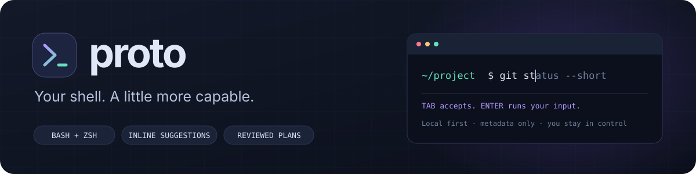
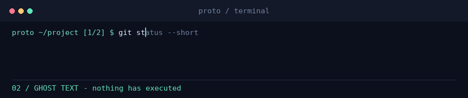
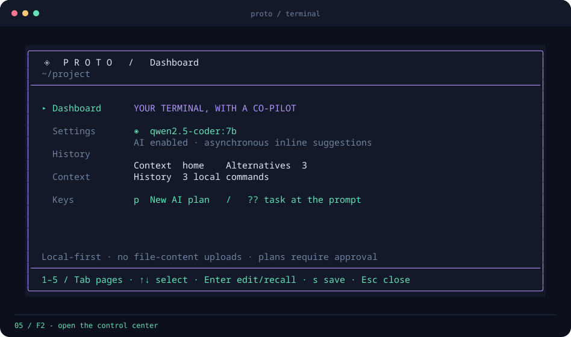
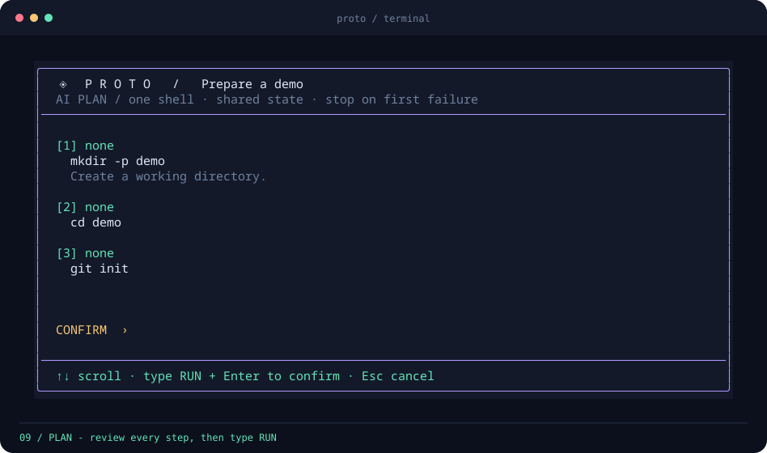
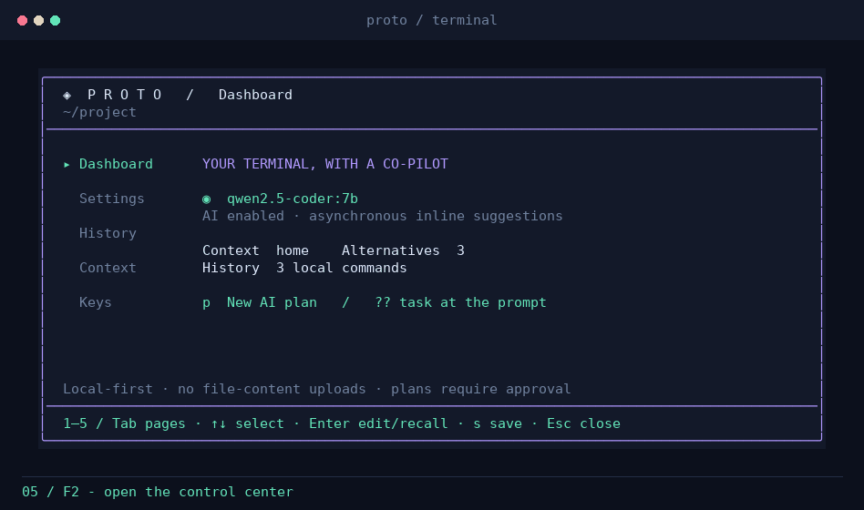
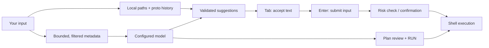

<a id="top"></a>
<div align="center">



**A terminal assistant that stays out of your way.**

Native Bash/Zsh · inline alternatives · reviewed command plans · settings & history TUI

[](https://github.com/ech00f/proto/actions/workflows/ci.yml) [](CMakeLists.txt)   [](https://github.com/ech00f/proto/stargazers)

[English](README.md) · [Русский](README.ru.md)

[Features](#features) · [Preview](#preview) · [Build](#build) · [Run](#run) · [Settings](#configuration) · [Plans](#reviewed-multi-command-plans) · [FAQ](#faq)

</div>

## Features

| At the prompt | Around the prompt |
| --- | --- |
| ⚡ **Local first, asynchronous AI**<br>Paths and common/history suggestions appear without waiting for inference. Requests are debounced; stale replies are discarded. | 🧭 **Your shell stays your shell**<br>Opt-in Bash/Zsh integration keeps your prompt, aliases, functions, directory state, and job control. |
| 🎛️ **More than one suggestion**<br>Cycle alternatives, accept a whole command or one word, and keep typing without accidental execution. | 🪟 **A control center, one key away**<br>F2 opens settings, searchable history, outbound-context preview, and a key reference. |
| 🛡️ **Review before running**<br>Risk labels flag deletion, overwrites, and elevated privileges. Plans wait for a full review and typed `RUN`. | 🔒 **Bounded metadata, not file uploads**<br>Local Ollama by default, configurable context, opt-in history sharing, and best-effort credential filtering. |

> [!IMPORTANT]
> **Tab accepts text. Enter runs only your actual input.**
> Plans require `RUN`; unaccepted ghost text never becomes a command.

## Preview

**Type → choose a variant → accept.** No commands execute in this demo.

<picture>
  <source media="(prefers-reduced-motion: reduce)" srcset="docs/terminal.svg">
  
</picture>

| Control center · **F2 / Ctrl+Space** | Command plans · **`?? task`** |
| :---: | :---: |
| [](docs/control-center.svg) | [](docs/plan.svg) |
| Change settings without leaving your draft. | Review every step before anything runs. |

<details>
<summary><strong>Explore the TUI: Settings → History → Plan → Danger</strong></summary>

<picture>
  <source media="(prefers-reduced-motion: reduce)" srcset="docs/settings.svg">
  
</picture>

Static views: [Settings](docs/settings.svg) · [History](docs/history.svg) · [Plan](docs/plan.svg) · [Danger confirmation](docs/danger.svg)

</details>

<sub>Captured from real disposable proto PTYs with a local fixture backend. The UI is real; model replies are illustrative. [Reproduce the visuals](#testing-and-development).</sub>

## Build

Requires a C++20 compiler, CMake 3.20+, libcurl 7.68+, and nlohmann/json 3.10+.
Python 3.9+ enables the HTTP/terminal integration tests; no Python packages are needed.
Bash integration requires Bash 4+; Zsh integration requires Zsh 5.9+.
Native inline Bash support also needs Bash development headers and GNU Readline
8.1+ headers. Without a compatible module, Bash uses on-demand completion.

<details>
<summary><strong>Ubuntu / Debian dependencies</strong></summary>

```sh
sudo apt install build-essential cmake ninja-build pkg-config libcurl4-openssl-dev \
  nlohmann-json3-dev python3 bash-builtins libreadline-dev zsh
```

</details>

<details>
<summary><strong>Arch Linux dependencies</strong></summary>

```sh
sudo pacman -S --needed base-devel cmake ninja pkgconf curl nlohmann-json python bash readline zsh
```

</details>

<details>
<summary><strong>macOS dependencies · Homebrew</strong></summary>

```sh
brew install cmake ninja pkg-config curl nlohmann-json bash readline
export PKG_CONFIG_PATH="$(brew --prefix curl)/lib/pkgconfig:$(brew --prefix readline)/lib/pkgconfig${PKG_CONFIG_PATH:+:$PKG_CONFIG_PATH}"
export CMAKE_PREFIX_PATH="$(brew --prefix):$(brew --prefix readline):$(brew --prefix bash)"
```

</details>

Then, from the repository:

```sh
cmake -S . -B build -G Ninja -DCMAKE_BUILD_TYPE=Release
cmake --build build --parallel
ctest --test-dir build --output-on-failure
```

Optional user-local installation (does not change your shell configuration):

```sh
cmake --install build --prefix "$HOME/.local"
```

This installs `bin/proto`, the integration scripts in `share/proto`, and the
optional Bash module in `lib/proto`. Use `-DPROTO_BUILD_BASH_MODULE=OFF` to skip
the module explicitly. Sanitizer builds also omit it.

## Run

### Inside Bash or Zsh

From the repository, source the script for your **current interactive shell**:

**Bash:**

```bash
PROTO_BIN="$PWD/build/proto"
source "$PWD/shell/proto.bash"
```

**Zsh:**

```zsh
PROTO_BIN="$PWD/build/proto"
source "$PWD/shell/proto.zsh"
```

Your prompt, aliases, functions, `cd`, pipelines, and job control remain native
to your shell. Tab and cursor movement retain their original behavior when
there is no suggestion to accept. Up/Down still browse your shell's history;
the menu shows proto's separate, filtered history.

For a user-local installation, set `PROTO_BIN="$HOME/.local/bin/proto"` and
source `"$HOME/.local/share/proto/proto.bash"` or `proto.zsh` instead.
On macOS, the system Bash 3.2 is too old: launch
`"$(brew --prefix bash)/bin/bash"` first, or use Zsh.

Integration is opt-in and never edits `.bashrc` or `.zshrc`. `proto-disable`
restores the hooks and bindings it replaced, keeping later user binding changes.
`proto-enable` enables it again.

If the Bash module cannot be built or loaded, **Ctrl+X Ctrl+A** requests a
suggestion and inserts it for review. Alt+↑/↓ or Alt+,/. switch variants;
Tab remains Bash's original completion key. This fallback is on-demand, not
ghost text, and may wait for the configured API timeout. Set
`PROTO_BASH_MODULE` to a module path, or to an empty value before sourcing to
force fallback mode. Zsh uses asynchronous ZLE widgets and needs no module.

### Standalone mode

```sh
./build/proto
./build/proto --no-ai
```

Standalone mode is a small terminal wrapper, not a full Bash/Zsh replacement.
See [keys and commands](#keys-and-commands) for its execution limits.

### Local model — no API key

Install [Ollama](https://ollama.com/), then start its server in a separate terminal
if the Ollama service is not already running:

```sh
ollama serve
```

In your working terminal:

```sh
ollama pull qwen2.5-coder:7b
./build/proto
```

For a lighter model, first pull it and set `PROTO_MODEL=qwen2.5-coder:1.5b`.
Cold model loads or CPU-only inference may need `PROTO_TIMEOUT_MS=15000`.
Ollama is a separate dependency: proto does not download models or start servers automatically.

### OpenAI-compatible cloud API

```sh
export PROTO_API_BASE=https://api.openai.com/v1
export PROTO_MODEL=gpt-4.1-mini
# Supply PROTO_API_KEY through your environment or secret manager.
./build/proto
```

Set `PROTO_API_KEY` before starting proto if your provider requires authentication.
Do not put real keys in Git or shell history. The API base is the provider's base
URL (usually ending in `/v1`); proto appends `/chat/completions`.
LM Studio and other compatible local servers work too: configure their base URL
and loaded model name. HTTP is accepted only for `localhost`, `127.0.0.1`, or `[::1]`;
remote providers require HTTPS. Redirects are not followed.

### Offline / scripting

```sh
./build/proto --no-ai
./build/proto --complete 'git st'
./build/proto --no-ai --complete 'cd ~/Doc'
./build/proto --context
```

`--complete` prints a complete command, not just its suffix, and **never executes it**.
No suggestion means empty stdout. Exit codes: `0` success/no suggestion, `1` invalid
arguments/configuration, `2` an AI failure with no local fallback. Interactive mode
requires a TTY and exits with the requested `exit` status or the last command's status.

## Configuration

Open the control center with **F2 / Ctrl+Space**, or run `./build/proto --menu`.
Its pages are Dashboard, Settings, History, Context, and Keys. Use `1`–`5` or
Tab to change pages, Up/Down to select, and Enter to edit or recall a command.
On History, `/` searches; recall only fills the input and never executes it.
On Dashboard, `p` starts a plan. Esc closes the menu without losing your draft.
The menu needs a terminal of at least 58 columns × 14 rows.

In Settings, **s saves and applies** changes to the current session, including
the model, endpoint, AI toggle, context scope, alternatives, timing, history,
and theme. Unsaved changes are discarded. Saved settings live in
`$XDG_CONFIG_HOME/proto/config.json` (otherwise `~/.config/proto/config.json`),
with directory mode `0700` and file mode `0600`. API keys are never saved or
shown in the menu.

At startup, defaults are overridden by the saved file, then by environment
variables. Menu changes do not export or change your shell environment;
environment overrides take effect again on restart or re-enabling integration.
`.env.example` documents defaults; proto does **not** automatically read `.env`
or shell startup files.

| Variable | Default | Meaning |
| --- | --- | --- |
| `PROTO_API_BASE` | `http://127.0.0.1:11434/v1` | OpenAI-compatible API base URL |
| `PROTO_MODEL` | `qwen2.5-coder:7b` | Provider's model identifier |
| `PROTO_API_KEY` | empty | Optional bearer key; never saved or printed by proto |
| `PROTO_AI` | `1` | `0` disables AI requests; local suggestions remain available |
| `PROTO_CONTEXT` | `home` | `none`: no directories; `cwd`: current directory; `home`: cwd + home directories |
| `PROTO_SUGGESTIONS` | `3` | Number of alternatives; range 1–5 |
| `PROTO_MAX_ENTRIES` | `80` | Maximum names per directory list; range 1–200 |
| `PROTO_DEBOUNCE_MS` | `250` | Quiet period before a request; range 0–5000 ms |
| `PROTO_TIMEOUT_MS` | `5000` | Request timeout; range 100–30000 ms |
| `PROTO_SEND_HISTORY` | `0` | Opt in to sending up to 8 recent non-sensitive proto commands |
| `PROTO_NO_HISTORY` | `0` | `1` disables proto disk history; native shell history is unaffected |
| `PROTO_THEME` | `aurora` | Menu theme: `aurora` or `midnight` |
| `PROTO_SHELL` | `$SHELL` or `/bin/sh` | Standalone execution shell; integrations use their current Bash/Zsh |

Boolean settings accept `0`/`1` or `false`/`true`.

## Reviewed multi-command plans

In an enabled shell or standalone prompt, type a task instead of a command:

```text
?? create a demo directory and initialize a git repository inside it
```

You can also type a task and press Ctrl+G, choose `p` in the menu, or use:

```sh
proto-plan 'create a demo directory and initialize git inside it'
./build/proto --plan 'create a demo directory and initialize git inside it'
./build/proto --run-plan 'create a demo directory and initialize git inside it'
```

`proto-plan` is available after sourcing the integration. `--plan` only prints
JSON; `--run-plan` reviews and executes an approved plan. Bash fallback Ctrl+G
marks the input as a task; Enter then opens its review.

Every plan contains 1–8 steps with commands, explanations, and risk labels
computed by proto. Review all steps, scrolling with Up/Down or End if needed,
then type **RUN** and press Enter. Esc / Ctrl+C cancels; nothing runs before
confirmation. The non-executing `--approve-plan` protocol returns a quoted
script only after the same review.

Steps execute in order in one subshell, sharing directory and environment
changes between steps and stopping on failure. Bash/Zsh integration also
inherits your shell's functions and aliases. The plan's `cd`, variables, and
shell options do not leak into the parent shell. Standalone `--run-plan` uses
`PROTO_SHELL` and does not inherit interactive aliases/functions. This is
**not a sandbox**: file writes, deletion, and other external effects persist.

## Privacy and safety

- The typed prefix (or plan task) and shell name are sent to the **configured** model endpoint.
- Default directory context contains only visible cwd names and top-level home
  directory names. There is no recursive scan, file-content upload, environment
  upload, or bash/zsh history import. Listings are bounded and sorted.
- Hidden/private directories, symlinks, and obvious secret/recovery names are
  excluded from AI metadata. Home paths are abbreviated to `~`.
- Commands containing recognizable keys, passwords, auth headers, URL credentials,
  or credential flags are not sent to the model or persisted in history.
- These filters are **best-effort**, not a guarantee that arbitrary secrets can be
  recognized. Even file names can be private: inspect `--context`, use
  `PROTO_CONTEXT=none`, choose a local model, or use `--no-ai` as appropriate.
- Proto history lives at `$XDG_STATE_HOME/proto/history` (otherwise
  `~/.local/state/proto/history`), with directory mode `0700` and file mode `0600`.
  Symlinked/hard-linked history is refused. Disk history stops growing at 1 MiB;
  up to 500 entries are kept in memory. Standalone mode and native Bash fall back
  to memory when disk history is busy or unwritable.
- Native Bash/Zsh keep their own history and environment policies. Proto's filters
  do not sanitize native shell history. The standalone wrapper removes
  `PROTO_API_KEY` from command environments; integration does not remove variables
  you exported into your own shell.
- Model output must preserve your prefix and contain only printable, single-line
  UTF-8. Terminal escapes, multiline commands, and changed prefixes are discarded.
- **Suggestions are untrusted. Review them before pressing Enter.** Tab only inserts
  text; Enter executes only the actual input, never an unaccepted suggestion.
- Deletion, destructive Git/disk operations, and other recognized `danger`
  commands require typed `RUN` confirmation, including manually entered commands.
  `sudo`, redirection, and possible overwrites receive `caution` warnings unless
  another operation raises the risk to `danger`. Inspect labels with
  `./build/proto --check 'rm old.txt'` (exit `3` for danger).
- Risk checks are heuristics, not a complete shell parser or security boundary.
  Aliases, functions, scripts, and complex shell expressions can hide behavior.
- Cloud providers may charge per request and retain submitted context according
  to their own policies. Nothing contacts a cloud API unless you configure one.

## Keys and commands

| Key | Action |
| --- | --- |
| Tab / Right at end of input | Accept the full suggestion |
| Ctrl+Right / Alt+Right | Accept the next word |
| Alt+Up / Alt+Down or Alt+, / Alt+. | Previous / next suggestion |
| F2 / Ctrl+Space | Open or close the settings/history control center |
| Ctrl+G / `?? task` | Review an AI command plan |
| Enter | Execute the input, **without** accepting ghost text |
| Esc (standalone); Esc Esc / Ctrl+] (native integration) | Dismiss the suggestion until the next edit |
| Up / Down | Native shell history in integration; proto history in standalone mode |
| Left / Right, Home / End | Move the cursor |
| Ctrl+A / Ctrl+E | Start / end of line |
| Ctrl+U / Ctrl+K / Ctrl+W | Delete before cursor / after cursor / previous word |
| Ctrl+C | Cancel input or interrupt a running foreground command |
| Ctrl+D | Exit an empty prompt |
| Ctrl+L | Clear the screen |

In native integration, Ctrl+X Ctrl+A requests suggestions explicitly. In Bash
fallback, this inserts the selected variant; the ghost-text acceptance and
dismissal keys above apply only to inline mode.

UTF-8 text, window resizing, and bracketed paste are supported. Standalone paste
turns newlines into spaces; native integration retains the shell's paste behavior.
Bash ghost text is clipped on wrapped lines, leaving native Readline rendering intact.

**Standalone only:** commands run through `$SHELL -c` (override with `PROTO_SHELL`). Simple `cd`, `cd -`,
`exit [status]`, `jobs`, and `fg [id]` are handled by proto. Ctrl+Z stops a foreground
command; `fg` resumes it. This is a small terminal wrapper, not a full bash/zsh
replacement. Interactive-shell aliases/functions are not imported. Complex
`cd ... && ...` expressions and command substitutions run in child shells and do
not change proto's own working directory. Background-job management is not implemented.

## Testing and development

CI builds with GCC and Clang on Linux and with Clang on macOS. Tests use a local fake
OpenAI-compatible HTTP server and disposable PTYs/directories: no real API keys,
remote model calls, or user-home contents are required. Coverage includes native
Bash, Bash fallback, Zsh widgets, stale replies, privacy, plans, settings,
binding restoration, and terminal cleanup. Missing optional shells/modules are
reported as skipped tests, not as tested integrations.

```sh
cmake -S . -B build-sanitize -G Ninja -DCMAKE_BUILD_TYPE=Debug \
  -DCMAKE_CXX_COMPILER=clang++ -DPROTO_ENABLE_SANITIZERS=ON
cmake --build build-sanitize --parallel
ctest --test-dir build-sanitize --output-on-failure
```

Native Bash modules are excluded from sanitizer builds because they load into
an unsanitized host shell; Release tests cover them separately. Set
`PROTO_TEST_BASH=/absolute/path/to/bash` to select a newer Bash for PTY tests,
especially on macOS. These fixtures test the protocol, not real model quality.

See [CONTRIBUTING.md](CONTRIBUTING.md) for the source layout and contribution checks.

README visuals are generated with the real binary and a disposable local
fixture. To regenerate them, install Pillow and provide a monospace font:

```sh
python3 docs/render_demo.py build/proto
```

Pillow is only needed for this optional renderer, not to build or run proto.
Use `--font /path/to/font.ttf` if `DejaVuSansMono.ttf` is unavailable.

## FAQ

<details>
<summary><strong>Which mode should I use?</strong></summary>

| Mode | Suggestions | Execution |
| --- | --- | --- |
| Bash + native module | Inline ghost text | Your existing Bash |
| Bash fallback | On-demand insertion: Ctrl+X Ctrl+A | Your existing Bash |
| Zsh 5.9+ | Asynchronous inline ghost text | Your existing Zsh |
| Standalone `proto` | Inline ghost text | Child shell; limited builtins |

Use native integration when you want to keep your normal shell setup. Use
standalone mode for a separate session or to try proto before sourcing anything.

</details>

<details>
<summary><strong>Do I need an API key? What happens if the model is offline?</strong></summary>

The default local Ollama backend needs no key. Cloud APIs may require one.
When inference fails, local suggestions remain available; AI plans require a
working backend. Cold starts can be slow: try `PROTO_TIMEOUT_MS=15000` or a
smaller model. Proto never installs or starts a model server automatically.

</details>

<details>
<summary><strong>Can I inspect or disable the information sent to AI?</strong></summary>

Yes: run `./build/proto --context` or open the Context page. Set
`PROTO_CONTEXT=none` to omit directory metadata, keep `PROTO_SEND_HISTORY=0`
to avoid sharing history, or set `PROTO_AI=0` to disable inference entirely.
The command prefix/task is still sent when AI is enabled. Filtering is
best-effort; see [privacy and safety](#privacy-and-safety).

</details>

<details>
<summary><strong>What if my terminal intercepts a hotkey?</strong></summary>

Try the alternate binding: F2 / Ctrl+Space, Alt+Up/Down / Alt+,/., or
Esc Esc / Ctrl+] in native shells. `./build/proto --menu` opens a standalone
menu without a hotkey. Inside the menu, `s` saves; Esc cancels an edit or closes it.

</details>

<details>
<summary><strong>How do requests become commands?</strong></summary>



There is no model-to-execution shortcut. Plan isolation protects parent-shell
state, not your filesystem: approved commands still have real external effects.

</details>

---

<div align="center">

Built with C++20 · [Contributing](CONTRIBUTING.md) · [Report a bug](https://github.com/ech00f/proto/issues/new) · [Back to top ↑](#top)

If proto makes your terminal a little nicer, a [star](https://github.com/ech00f/proto) helps others find it.

</div>
