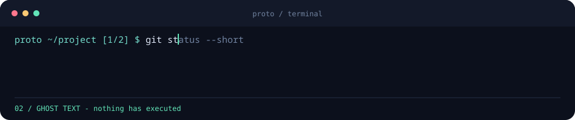

# proto — AI-автодополнение в терминале

[English documentation](README.md)

Терминальная оболочка на **C++20** с подсказками как в GitHub Copilot: печатаешь
команду, нейросеть предлагает продолжение серым текстом прямо в строке.
`Tab` принимает подсказку, `Enter` выполняет только введённую строку.



Запросы выполняются в фоне после короткой паузы. При изменении строки старый
запрос отменяется; запоздавший ответ не может подменить новый ввод. Без нейросети
остаются локальные подсказки путей, распространённых команд и истории proto.

## Сборка

Нужны компилятор C++20, CMake 3.20+, libcurl 7.68+ и nlohmann/json 3.10+.

Ubuntu / Debian:

```sh
sudo apt install build-essential cmake ninja-build pkg-config libcurl4-openssl-dev nlohmann-json3-dev
cmake -S . -B build -G Ninja -DCMAKE_BUILD_TYPE=Release
cmake --build build --parallel
ctest --test-dir build --output-on-failure
```

Arch Linux:

```sh
sudo pacman -S --needed base-devel cmake ninja pkgconf curl nlohmann-json python
```

Инструкции для macOS и установки в `~/.local/bin` есть в [README.md](README.md#build).

## Локальная нейросеть

Установи [Ollama](https://ollama.com/). Если его сервис не запущен, в отдельном
терминале выполни:

```sh
ollama serve
```

Затем в основном терминале:

```sh
ollama pull qwen2.5-coder:7b
./build/proto
```

Ключ API не нужен. Для слабого компьютера можно скачать `qwen2.5-coder:1.5b`
и запустить `PROTO_MODEL=qwen2.5-coder:1.5b ./build/proto`. Если модель долго
загружается, увеличь тайм-аут: `PROTO_TIMEOUT_MS=15000 ./build/proto`.
Proto сам не устанавливает Ollama и не скачивает модели.

## Внешний API

Подойдёт OpenAI или другой сервер с совместимым `/chat/completions` API:

```sh
export PROTO_API_BASE=https://api.openai.com/v1
export PROTO_MODEL=gpt-4.1-mini
# Задай PROTO_API_KEY через окружение или менеджер секретов.
./build/proto
```

Настоящий ключ нельзя коммитить или оставлять в истории команд. Для удалённых API
обязателен HTTPS; HTTP разрешён только для localhost / 127.0.0.1 / [::1].
Для LM Studio укажи его локальный адрес и имя загруженной модели.

## Что видит нейросеть

По умолчанию: набранный префикс команды, имя оболочки, видимые имена файлов/папок
текущего каталога и имена папок верхнего уровня домашнего каталога.
**Содержимое файлов из этих каталогов не читается и не отправляется.** Нет рекурсивного сканирования,
передачи окружения или импорта истории bash/zsh. Скрытые каталоги, симлинки и
очевидные имена секретных файлов исключаются из контекста.

```sh
./build/proto --context                   # посмотреть передаваемые метаданные
PROTO_CONTEXT=cwd ./build/proto           # только текущий каталог
PROTO_CONTEXT=none ./build/proto          # без метаданных каталогов
./build/proto --no-ai                     # совсем без сетевых запросов
```

История proto хранится локально с правами `0600`; нейросеть получает её только
при явном `PROTO_SEND_HISTORY=1`. `PROTO_NO_HISTORY=1` отключает запись на диск.
Команды с распознаваемыми ключами, паролями и заголовками авторизации не
отправляются и не сохраняются. Фильтр не может гарантированно распознать любой
секрет: для приватных задач выбирай локальную модель или `--no-ai`.

## Управление

| Клавиша | Действие |
| --- | --- |
| `Tab` / `→` в конце строки | Принять всё продолжение |
| `Ctrl+→` / `Alt+→` | Принять следующее слово |
| `Enter` | Выполнить ввод, не принимая серую подсказку |
| `Esc` | Скрыть подсказку до следующего изменения |
| `↑` / `↓` | История proto |
| `Home` / `End`, `Ctrl+A` / `Ctrl+E` | Начало / конец строки |
| `Ctrl+U` / `Ctrl+K` / `Ctrl+W` | Удаление до курсора / после курсора / предыдущего слова |
| `Ctrl+C` | Отменить ввод или прервать команду |
| `Ctrl+D` | Выйти, если строка пустая |
| `Ctrl+L` | Очистить экран |

Поддерживаются UTF-8, изменение ширины окна и bracketed paste: переносы строк
при такой вставке превращаются в пробелы и не запускают команды автоматически.

Есть встроенные `cd`, `cd -`, `exit [код]`, `jobs` и `fg [номер]`.
`Ctrl+Z` останавливает выполняемую команду; `fg` возвращает её на передний план.
Остальные команды выполняются через `$SHELL -c` (можно задать `PROTO_SHELL`).
Это не полноценная замена bash/zsh: интерактивные алиасы не импортируются, а
сложные конструкции вроде `cd folder && pwd` меняют каталог только дочернего процесса.

Для скриптов:

```sh
./build/proto --complete 'git st'          # полная команда, без выполнения
./build/proto --no-ai --complete 'cd ~/Doc'
```

Все переменные окружения и ограничения описаны в
[README.md](README.md#configuration). Настройки читаются при запуске;
файл `.env` автоматически не загружается.

**Проверяй предложенную команду перед выполнением. Нейросеть может ошибаться.**
