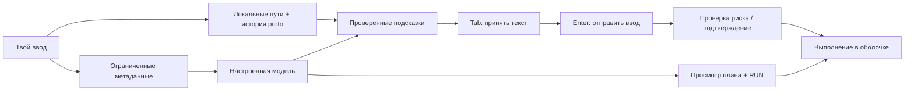

<a id="top"></a>
<div align="center">


**Терминальный помощник, который не мешает работать.**

Родные Bash/Zsh · варианты прямо в строке · проверяемые планы команд · TUI настроек и истории

[](https://github.com/ech00f/proto/actions/workflows/ci.yml) [](CMakeLists.txt)   [](https://github.com/ech00f/proto/stargazers)

[English](README.md) · [Русский](README.ru.md)

[Возможности](#features) · [Демо](#preview) · [Сборка](#build) · [Запуск](#run) · [Автозапуск](#autostart) · [Настройки](#settings) · [Планы](#plans) · [FAQ](#faq)

</div>

<a id="features"></a>
## Возможности

| Прямо в строке | Вокруг неё |
| --- | --- |
| ⚡ **Сначала локальные подсказки, затем AI**<br>Пути, распространённые команды и история появляются без ожидания нейросети. Запросы идут в фоне; устаревшие ответы отбрасываются. | 🧭 **Твоя оболочка остаётся твоей**<br>Подключение по желанию: привычный prompt, алиасы, функции, `cd` и управление заданиями сохраняются. |
| 🎛️ **Не одна подсказка, а варианты**<br>Переключай продолжения, принимай всю команду или одно слово и продолжай печатать без случайного выполнения. | 🪟 **Панель управления по одной клавише**<br>F2 открывает настройки, поиск по истории, просмотр контекста и справку по клавишам. |
| 🛡️ **Сначала просмотр — потом запуск**<br>Метки риска предупреждают об удалении, перезаписи и повышении привилегий. План ждёт полного просмотра и ввода `RUN`. | 🔒 **Метаданные вместо загрузки файлов**<br>Локальный Ollama по умолчанию, ограниченный контекст, история только по согласию и фильтрация распознаваемых секретов. |
| 🔁 **Готово после включения компьютера**<br>Необязательная user-служба systemd обрабатывает AI-запросы; явно установленные shell-хуки подключают proto в каждом новом терминале. | 🔌 **Твой backend, без обязательного Ollama**<br>Ollama, LM Studio или совместимый HTTPS API. Демон запускается без сервера модели и получает настройки от текущей сессии. |

> [!IMPORTANT]
> **Tab принимает текст. Enter выполняет только настоящий ввод.**
> План требует `RUN`; непринятая серая подсказка никогда не становится командой.

<a id="preview"></a>
## Демо

**Набери → выбери вариант → прими текст.** В этом демо команды не выполняются.

<picture>
  <source media="(prefers-reduced-motion: reduce)" srcset="docs/terminal.svg">
  
</picture>

| Панель управления · **F2 / Ctrl+Space** | План команд · **`?? задача`** |
| :---: | :---: |
| [](docs/control-center.svg) | [](docs/plan.svg) |
| Меняй настройки, не теряя набранную строку. | Проверь каждый шаг до первого запуска. |

<details>
<summary><strong>Посмотреть TUI: настройки → история → план → предупреждение</strong></summary>

<picture>
  <source media="(prefers-reduced-motion: reduce)" srcset="docs/settings.svg">
  
</picture>

Статичные экраны: [Настройки](docs/settings.svg) · [История](docs/history.svg) · [План](docs/plan.svg) · [Подтверждение опасной команды](docs/danger.svg)

</details>

<sub>Записано из настоящих временных PTY-сессий proto с локальным тестовым API. Интерфейс настоящий; ответы модели демонстрационные. [Как пересоздать изображения](#development).</sub>

<a id="build"></a>
## Сборка

Нужны компилятор C++20, CMake 3.20+, libcurl 7.68+ и nlohmann/json 3.10+.
Для тестов нужен Python 3.9+ без дополнительных пакетов.
Интеграция требует Bash 4+ или Zsh 5.9+. Для серых подсказок в Bash также нужны
заголовки Bash и GNU Readline 8.1+; без совместимого модуля работает режим по запросу.

<details>
<summary><strong>Зависимости Ubuntu / Debian</strong></summary>

```sh
sudo apt install build-essential cmake ninja-build pkg-config libcurl4-openssl-dev \
  nlohmann-json3-dev python3 bash-builtins libreadline-dev zsh
```

</details>

<details>
<summary><strong>Зависимости Arch Linux</strong></summary>

```sh
sudo pacman -S --needed base-devel cmake ninja pkgconf curl nlohmann-json python bash readline zsh
```

</details>

<details>
<summary><strong>Зависимости macOS · Homebrew</strong></summary>

```sh
brew install cmake ninja pkg-config curl nlohmann-json bash readline
export PKG_CONFIG_PATH="$(brew --prefix curl)/lib/pkgconfig:$(brew --prefix readline)/lib/pkgconfig${PKG_CONFIG_PATH:+:$PKG_CONFIG_PATH}"
export CMAKE_PREFIX_PATH="$(brew --prefix):$(brew --prefix readline):$(brew --prefix bash)"
```

</details>

Затем из каталога репозитория:

```sh
cmake -S . -B build -G Ninja -DCMAKE_BUILD_TYPE=Release
cmake --build build --parallel
ctest --test-dir build --output-on-failure
```

Необязательная установка для текущего пользователя:

```sh
cmake --install build --prefix "$HOME/.local"
```

Будут установлены `bin/proto`, скрипты в `share/proto` и, если собран, Bash-модуль
в `lib/proto`. Файлы запуска оболочки не меняются. Флаг
`-DPROTO_BUILD_BASH_MODULE=OFF` отключает сборку модуля; sanitizer-сборки также его исключают.

<a id="run"></a>
## Запуск

### Внутри Bash или Zsh

Из репозитория подключи скрипт для **текущей интерактивной оболочки**.

**Bash:**

```bash
PROTO_BIN="$PWD/build/proto"
source "$PWD/shell/proto.bash"
```

**Zsh:**

```zsh
PROTO_BIN="$PWD/build/proto"
source "$PWD/shell/proto.zsh"
```

Prompt, алиасы, функции, `cd`, конвейеры и задания остаются родными. Если подсказки
нет, Tab и перемещение курсора работают как прежде. `↑`/`↓` листают обычную
историю оболочки; меню показывает отдельную, отфильтрованную историю proto.

После установки в `~/.local` задай `PROTO_BIN="$HOME/.local/bin/proto"` и подключи
`"$HOME/.local/share/proto/proto.bash"` или `proto.zsh`.
На macOS системный Bash 3.2 слишком старый: сначала запусти
`"$(brew --prefix bash)/bin/bash"` либо используй Zsh.

Подключение через `source` никогда не редактирует `.bashrc` или `.zshrc`.
[Установщик автозапуска](#autostart) добавляет блок только по явному флагу `--shell`.
`proto-disable` восстанавливает заменённые привязки и обработчики,
сохраняя более поздние изменения пользователя. `proto-enable` подключает её снова.

Если Bash-модуль не собрался или не загрузился, **Ctrl+X Ctrl+A** запрашивает
подсказку и вставляет её для проверки. Alt+↑/↓ или Alt+,/. переключают варианты;
Tab остаётся обычным дополнением Bash. Это режим по запросу, без серого текста,
который может ждать до тайм-аута API. `PROTO_BASH_MODULE` задаёт путь к модулю;
пустое значение перед `source` принудительно включает fallback. Zsh использует
асинхронные ZLE-виджеты и не требует модуля.

### Отдельная сессия proto

```sh
./build/proto
./build/proto --no-ai
```

Это небольшой терминальный wrapper, а не полноценная замена Bash/Zsh.
Ограничения выполнения описаны в разделе [управления](#keys).

### Локальная нейросеть

Установи [Ollama](https://ollama.com/). Если его сервис не запущен, в отдельном
терминале выполни:

```sh
ollama serve
```

Затем в основном терминале:

```sh
ollama pull qwen2.5-coder:7b
./build/proto
```

Ключ API не нужен. Для слабого компьютера можно скачать `qwen2.5-coder:1.5b`
и запустить `PROTO_MODEL=qwen2.5-coder:1.5b ./build/proto`. Если модель долго
загружается, увеличь тайм-аут: `PROTO_TIMEOUT_MS=15000 ./build/proto`.
Proto сам не устанавливает Ollama и не скачивает модели.

### Внешний API

Подойдёт OpenAI или другой сервер с совместимым `/chat/completions` API:

```sh
export PROTO_API_BASE=https://api.openai.com/v1
export PROTO_MODEL=gpt-4.1-mini
# Задай PROTO_API_KEY через окружение или менеджер секретов.
./build/proto
```

Настоящий ключ нельзя коммитить или оставлять в истории команд. Для удалённых API
обязателен HTTPS; HTTP разрешён только для localhost / 127.0.0.1 / [::1].
Для LM Studio укажи его локальный адрес и имя загруженной модели.
Proto добавляет `/chat/completions` к базовому адресу и не следует редиректам.

### Для скриптов и работы без AI

```sh
./build/proto --complete 'git st'
./build/proto --suggest-json 'git st'
./build/proto --no-ai --complete 'cd ~/Doc'
./build/proto --context
```

`--complete` печатает полную команду, не только продолжение, и **не выполняет её**.
Нет подсказки — пустой stdout. Коды: `0` — успех/нет подсказки, `1` — неверные
аргументы/настройки, `2` — сбой AI без локального варианта. `--daemon-status`
возвращает `3`, если демон не запущен. Интерактивный режим требует TTY и возвращает
код `exit` или последней команды.

<a id="autostart"></a>
## Автозапуск · Linux / systemd

Установи один раз — служба запускается автоматически, а новые терминалы сами
подключают proto:

```sh
python3 scripts/install.py --build-dir build --systemd --shell zsh
```

При необходимости выбери `--shell bash` или `--shell both`. По умолчанию файлы
устанавливаются в `~/.local` (`--prefix` меняет путь), `proto.service` — в
пользовательскую конфигурацию systemd. В выбранный rc-файл добавляется только
помеченный блок; для Zsh учитывается `ZDOTDIR`. Повторная установка не дублирует
блок и сохраняет остальные настройки. Изменённые установленные файлы и связанные
rc-файлы не перезаписываются. Путь установки службы systemd не должен содержать
кавычки, обратный слеш и управляющие символы. Без `--shell` / `--systemd`
устанавливается лишь программа. Уже открытые терминалы не меняются: открой новый.

Чтобы служба запускалась **при загрузке компьютера, даже до входа**, явно
включи linger:

```sh
python3 scripts/install.py --build-dir build --systemd --shell zsh --linger
```

Linger оставляет пользовательский менеджер запущенным после выхода и может
требовать одобрения администратора. Без него служба стартует с user-менеджером,
обычно при входе в систему. Общесистемная служба и автоматический `sudo` не используются.

```sh
systemctl --user status proto.service
~/.local/bin/proto --daemon-status
journalctl --user -u proto.service -b
```

Служба запускает **сам proto**, не интерактивный prompt и не Ollama. Она передаёт
AI-запросы Bash/Zsh и отдельных сессий настроенному OpenAI-совместимому endpoint.
Модель, адрес, тайм-аут и ключ API приходят из каждой сессии; сохранение настроек
в меню не требует перезапуска демона. Ollama необязателен. Если выбран локальный
сервер модели, его автозапуск настраивается отдельно. Готовность демона не
означает, что нейросеть доступна.

Демон слушает только `$XDG_RUNTIME_DIR/proto/proto.sock`: каталог `0700`, сокет
`0600`, проверка одного пользователя с обеих сторон. Он получает уже
отфильтрованные метаданные, не сканирует каталоги, не загружает историю оболочки,
не сохраняет ключи и не выполняет команды. Одновременно обрабатываются до восьми
запросов; отключение клиента отменяет запрос. Просмотр планов и подтверждение
опасных команд остаются в терминале. Другие процессы твоего пользователя входят
в ту же границу доверия.

Если демона нет, клиент обращается к выбранному API напрямую. При ошибке
запущенного демона запрос не повторяется напрямую, чтобы не дублировать вызовы.
Локальные подсказки остаются доступными. `PROTO_DAEMON=0` всегда выбирает прямые
запросы, `PROTO_DAEMON_SOCKET` меняет путь сокета. Ручной `proto --daemon` с
настроенным приватным сокетом работает и на macOS; установщик systemd — только для Linux.

Отключить автозапуск, не удаляя установленные файлы и остальные настройки:

```sh
python3 scripts/install.py --remove-shell zsh --disable-service
```

<a id="settings"></a>
## Настройки и история

**F2 / Ctrl+Space** открывает панель управления. Отдельно её можно запустить через
`./build/proto --menu`. Страницы: Dashboard, Settings, History, Context и Keys.
`1`–`5` или Tab меняют страницу, `↑`/`↓` выбирают пункт, Enter редактирует настройку
или возвращает команду в строку — **без выполнения**. На History `/` включает
поиск, на Dashboard `p` начинает план. Esc закрывает меню, сохраняя черновик ввода.
Минимальный размер окна: 58 столбцов × 14 строк.

В Settings **s сохраняет и применяет** изменения в текущей сессии: модель,
адрес API, AI, контекст, число вариантов, задержки, историю и тему.
Несохранённые изменения отбрасываются. Файл настроек:
`$XDG_CONFIG_HOME/proto/config.json`, иначе `~/.config/proto/config.json`;
права каталога `0700`, файла `0600`. Ключи API в меню не показываются и не сохраняются.

При запуске порядок такой: значения по умолчанию → сохранённый файл → переменные
окружения. Меню не меняет и не экспортирует окружение оболочки. При перезапуске
или повторном включении интеграции переменные снова имеют приоритет.
`.env.example` перечисляет значения; `.env` и файлы запуска оболочки автоматически
не загружаются.

| Переменная | По умолчанию | Назначение |
| --- | --- | --- |
| `PROTO_API_BASE` | `http://127.0.0.1:11434/v1` | Базовый адрес совместимого API |
| `PROTO_MODEL` | `qwen2.5-coder:7b` | Имя модели у провайдера |
| `PROTO_API_KEY` | пусто | Bearer-ключ; proto не сохраняет и не печатает его |
| `PROTO_AI` | `1` | `0` отключает AI, оставляя локальные подсказки |
| `PROTO_CONTEXT` | `home` | `none`: без каталогов; `cwd`: текущий; `home`: текущий + домашние папки |
| `PROTO_SUGGESTIONS` | `3` | Число вариантов: 1–5 |
| `PROTO_MAX_ENTRIES` | `80` | Имен в каждом списке каталогов: 1–200 |
| `PROTO_DEBOUNCE_MS` | `250` | Пауза перед запросом: 0–5000 мс |
| `PROTO_TIMEOUT_MS` | `5000` | Тайм-аут запроса: 100–30000 мс |
| `PROTO_SEND_HISTORY` | `0` | Явное согласие на передачу до 8 недавних несекретных команд proto |
| `PROTO_NO_HISTORY` | `0` | `1` отключает запись истории proto на диск; историю оболочки не меняет |
| `PROTO_THEME` | `aurora` | Тема меню: `aurora` или `midnight` |
| `PROTO_SHELL` | `$SHELL` либо `/bin/sh` | Оболочка отдельной сессии; интеграция использует текущую Bash/Zsh |
| `PROTO_DAEMON` | `1` | Использовать user-демон, если доступен; `0` — прямые API-запросы |
| `PROTO_DAEMON_SOCKET` | `$XDG_RUNTIME_DIR/proto/proto.sock` | Необязательный путь приватного Unix-сокета; без runtime-каталога автоматического подключения нет |

Логические настройки принимают `0`/`1` или `false`/`true`.

<a id="plans"></a>
## Проверяемые планы команд

В подключённой оболочке или отдельном prompt proto введи задачу:

```text
?? создай каталог demo и инициализируй внутри git-репозиторий
```

Также можно набрать задачу и нажать Ctrl+G, выбрать `p` в меню или выполнить:

```sh
proto-plan 'создай каталог demo и инициализируй внутри git-репозиторий'
./build/proto --plan 'создай каталог demo и инициализируй внутри git-репозиторий'
./build/proto --run-plan 'создай каталог demo и инициализируй внутри git-репозиторий'
```

`proto-plan` появляется после подключения интеграции. `--plan` только печатает JSON;
`--run-plan` показывает и выполняет подтверждённый план. В Bash fallback Ctrl+G
помечает ввод как задачу; Enter затем открывает просмотр.

План содержит 1–8 шагов: команда, пояснение и вычисленная самим proto метка риска.
Просмотри все шаги; при необходимости прокрути `↑`/`↓` или End. Затем введи
**RUN** и нажми Enter. Esc / Ctrl+C отменяет — до подтверждения ничего не запускается.
Протокол `--approve-plan` после такой же проверки лишь печатает экранированный
скрипт, но сам его не выполняет.

Шаги идут последовательно в одной подоболочке, передавая друг другу каталог и
окружение и останавливаясь при ошибке. Bash/Zsh также наследуют функции и алиасы
текущей оболочки. Изменения `cd`, переменных и shell-опций не попадают обратно
в родительскую сессию. Отдельный `--run-plan` использует `PROTO_SHELL` и не
импортирует интерактивные функции/алиасы. **Это не песочница:** изменения файлов,
удаление и другие внешние эффекты сохраняются.

<a id="privacy"></a>
## Приватность и безопасность

По умолчанию: набранный префикс команды или задача плана, имя оболочки, видимые имена файлов/папок
текущего каталога и имена папок верхнего уровня домашнего каталога.
**Содержимое файлов из этих каталогов не читается и не отправляется.** Нет рекурсивного сканирования,
передачи окружения или импорта истории bash/zsh. Скрытые каталоги, симлинки и
очевидные имена секретных файлов исключаются из контекста.

```sh
./build/proto --context                   # посмотреть передаваемые метаданные
PROTO_CONTEXT=cwd ./build/proto           # только текущий каталог
PROTO_CONTEXT=none ./build/proto          # без метаданных каталогов
./build/proto --no-ai                     # совсем без сетевых запросов
```

История proto хранится локально с правами `0600`; нейросеть получает её только
при явном `PROTO_SEND_HISTORY=1`. `PROTO_NO_HISTORY=1` отключает запись на диск.
Путь: `$XDG_STATE_HOME/proto/history`, иначе `~/.local/state/proto/history`.
Каталог имеет права `0700`; симлинки и hard links для истории отвергаются.
Файл ограничен 1 МиБ, в памяти хранится до 500 записей. При недоступной или
занятой истории отдельная сессия и Bash-модуль переходят к хранению в памяти.
Команды с распознаваемыми ключами, паролями и заголовками авторизации не
отправляются и не сохраняются. Фильтр не может гарантированно распознать любой
секрет: для приватных задач выбирай локальную модель или `--no-ai`.

Обычная история и окружение Bash/Zsh сохраняют свои правила: proto не очищает
историю оболочки и не удаляет из неё экспортированные переменные. Отдельный
wrapper исключает `PROTO_API_KEY` из окружения выполняемых команд.

Ответ должен сохранять префикс и состоять из печатного однострочного UTF-8.
Переводы строк, управляющие последовательности и изменённые префиксы отбрасываются.

Удаление, разрушительные Git/дисковые операции и другие распознанные команды
`danger` требуют ввода `RUN`, даже если команда набрана вручную. `sudo`,
перенаправление вывода и возможная перезапись отмечаются как `caution`, если
другая операция не повышает риск до `danger`:

```sh
./build/proto --check 'rm old.txt'
```

Для `danger` возвращается код `3`. Проверка риска — эвристика, не полноценный
парсер и не граница безопасности: функции, алиасы, скрипты и сложные выражения
могут скрыть опасное действие. Внешний API вызывается только после настройки;
его тарифы и правила хранения данных зависят от провайдера.

<a id="keys"></a>
## Управление

| Клавиша | Действие |
| --- | --- |
| `Tab` / `→` в конце строки | Принять всё продолжение |
| `Ctrl+→` / `Alt+→` | Принять следующее слово |
| `Alt+↑` / `Alt+↓` либо `Alt+,` / `Alt+.` | Предыдущий / следующий вариант |
| `F2` / `Ctrl+Space` | Панель настроек и истории |
| `Ctrl+G` / `?? задача` | Просмотр AI-плана |
| `Enter` | Выполнить ввод, не принимая серую подсказку |
| `Esc` в отдельной сессии; `Esc Esc` / `Ctrl+]` в интеграции | Скрыть подсказку до следующего изменения |
| `↑` / `↓` | Родная история в интеграции; история proto в отдельной сессии |
| `Home` / `End`, `Ctrl+A` / `Ctrl+E` | Начало / конец строки |
| `Ctrl+U` / `Ctrl+K` / `Ctrl+W` | Удаление до курсора / после курсора / предыдущего слова |
| `Ctrl+C` | Отменить ввод или прервать команду |
| `Ctrl+D` | Выйти, если строка пустая |
| `Ctrl+L` | Очистить экран |

В интеграции `Ctrl+X Ctrl+A` запрашивает подсказки явно. В Bash fallback это
сразу вставляет выбранный вариант; клавиши принятия и скрытия серого текста
относятся только к inline-режиму.

Поддерживаются UTF-8, изменение ширины окна и bracketed paste. Отдельная сессия
превращает переносы вставленного текста в пробелы; интеграция оставляет родное
поведение вставки. На перенесённых строках Bash ограничивает серое продолжение,
не ломая отрисовку Readline.

**Только для отдельной сессии:** есть встроенные `cd`, `cd -`, `exit [код]`, `jobs` и `fg [номер]`.
`Ctrl+Z` останавливает выполняемую команду; `fg` возвращает её на передний план.
Остальные команды выполняются через `$SHELL -c` (можно задать `PROTO_SHELL`).
Это не полноценная замена bash/zsh: интерактивные алиасы не импортируются, а
сложные конструкции вроде `cd folder && pwd` меняют каталог только дочернего процесса.

<a id="development"></a>
## Тестирование и разработка

CI проверяет GCC и Clang на Linux и Clang на macOS. Тесты используют локальный
фиктивный API, временные каталоги и PTY — без реальных ключей, удалённых моделей
или содержимого пользовательского HOME. Проверяются Bash, fallback, Zsh,
устаревшие ответы, приватность, планы, настройки, возврат привязок и терминала.
Отсутствующие необязательные оболочки/модули отмечаются как пропущенные тесты.
Тесты демона и установщика проверяют отмену, параллельные запросы, приватные
сокеты, startup-блоки и сохранение пользовательских изменений — без запуска
реальных служб и изменения rc-файлов.

```sh
cmake -S . -B build-sanitize -G Ninja -DCMAKE_BUILD_TYPE=Debug \
  -DCMAKE_CXX_COMPILER=clang++ -DPROTO_ENABLE_SANITIZERS=ON
cmake --build build-sanitize --parallel
ctest --test-dir build-sanitize --output-on-failure
```

Bash-модуль загружается в обычную оболочку, поэтому исключён из sanitizer-сборок;
его отдельно проверяет Release. `PROTO_TEST_BASH=/абсолютный/путь/к/bash` выбирает
нужный Bash для PTY-тестов, особенно на macOS. Фиктивный API проверяет протокол,
а не качество настоящей модели. Структура проекта и правила — в [CONTRIBUTING.md](CONTRIBUTING.md).

Изображения README можно пересоздать настоящим бинарником с временным тестовым
API. Для необязательного рендера нужны Pillow и моноширинный шрифт:

```sh
python3 docs/render_demo.py build/proto
```

Для самой программы Pillow не нужен. Если `DejaVuSansMono.ttf` недоступен,
передай `--font /путь/к/шрифту.ttf`.

<a id="faq"></a>
## FAQ

<details>
<summary><strong>Какой режим выбрать?</strong></summary>

| Режим | Подсказки | Выполнение |
| --- | --- | --- |
| Bash с нативным модулем | Серое продолжение в строке | Текущий Bash |
| Bash fallback | Вставка по Ctrl+X Ctrl+A | Текущий Bash |
| Zsh 5.9+ | Асинхронное серое продолжение | Текущий Zsh |
| Отдельный `proto` | Серое продолжение | Дочерняя оболочка, ограниченные builtins |

Интеграция подходит для привычной рабочей оболочки. Отдельная сессия — чтобы
попробовать proto без подключения скриптов или работать в отдельном окружении.

</details>

<details>
<summary><strong>Нужен ли API-ключ? Что будет без нейросети?</strong></summary>

Локальному Ollama ключ не нужен; внешнему провайдеру может понадобиться.
При сбое AI локальные подсказки остаются, но генерация планов требует рабочего
backend. Для долгого холодного запуска попробуй `PROTO_TIMEOUT_MS=15000` или
меньшую модель. Proto сам не устанавливает и не запускает сервер нейросети.

</details>

<details>
<summary><strong>Можно посмотреть или отключить передаваемый контекст?</strong></summary>

Да: `./build/proto --context` или страница Context. `PROTO_CONTEXT=none` убирает
метаданные каталогов, `PROTO_SEND_HISTORY=0` не даёт делиться историей, а
`PROTO_AI=0` отключает AI. При включённом AI префикс/задача всё равно передаётся.
Фильтр не гарантирует распознавание любого секрета: смотри раздел [безопасности](#privacy).

</details>

<details>
<summary><strong>Терминал перехватывает сочетание клавиш — что делать?</strong></summary>

Попробуй альтернативу: F2 / Ctrl+Space, Alt+↑/↓ / Alt+,/., а в родных оболочках
Esc Esc / Ctrl+]. `./build/proto --menu` открывает отдельное меню без hotkey.
Внутри `s` сохраняет настройки; Esc отменяет редактирование или закрывает меню.

</details>

<details>
<summary><strong>Как ответ модели становится командой?</strong></summary>



Прямого пути от модели к выполнению нет. Изоляция плана защищает состояние
родительской оболочки, не файловую систему: одобренные команды имеют реальные эффекты.

</details>

---

<div align="center">

C++20 · [Участие в разработке](CONTRIBUTING.md) · [Сообщить об ошибке](https://github.com/ech00f/proto/issues/new) · [Наверх ↑](#top)

Если с proto терминал стал удобнее, [звезда](https://github.com/ech00f/proto) поможет другим найти проект.

</div>
